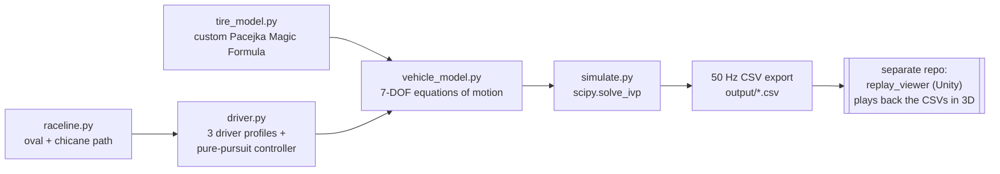

# vehicle_sim — 7-DOF Vehicle Dynamics Simulation


[Türkçe sürüm →](README.md)

A 7-degree-of-freedom vehicle dynamics simulation built on a from-scratch
Pacejka "Magic Formula" tire model. Three driver profiles
(baseline/conservative/aggressive) follow a fixed raceline, the equations
of motion are solved with `scipy.solve_ivp`, and the results are exported as
50 Hz CSV files — consumed by a separate Unity repo, **replay_viewer**, for
3D playback.

## Screenshots

| Single-driver validation plot | Three-driver comparison | Pacejka validation |
|---|---|---|
|  |  |  |

## Architecture / Data Flow



## What the 7 DOF are

Dynamic degrees of freedom (each with its own inertia / generalized force):

1. `vx` — body-frame longitudinal velocity
2. `vy` — body-frame lateral velocity
3. `r` — yaw rate
4-7. `w_fl, w_fr, w_rl, w_rr` — the four wheels' rotational speeds

Ride (bounce), roll and pitch were **not** added as separate state
variables. Instead, all three are represented through a **quasi-static load
transfer model** (`vehicle_model._wheel_normal_loads`) that shifts the
normal load (Fz) front/rear under longitudinal acceleration and left/right
under lateral acceleration. This matches the "at least
longitudinal+lateral+yaw+4 wheels" option explicitly allowed by the task
brief, and the full rationale is documented in the docstring at the top of
`vehicle_model.py`.

`X, Y, psi` (world position/heading) are also integrated, but kinematically
— they have no inertia of their own and are not part of the 7 dynamic DOF.
They exist only to place the car in the world and to write the CSV for the
Unity replay.

## Code layout

| File | Role |
|---|---|
| `tire_model.py` | Our own Pacejka Magic Formula implementation (longitudinal + lateral + friction-circle combined slip). No third-party tire library is imported. |
| `vehicle_model.py` | 7-DOF equations of motion, Ackermann steering, quasi-static load transfer. |
| `raceline.py` | Fixed "oval + chicane" raceline (analytic arc-length parametrization). |
| `driver.py` | Three driver profiles (baseline/conservative/aggressive) + pure-pursuit path-following controller + curvature-based speed profile. |
| `simulate.py` | `scipy.integrate.solve_ivp` solve + 50 Hz CSV export. |
| `validate_tire.py` | Compares our Pacejka implementation against `commonroad-vehicle-models` (GPLv3) **shape-only**, in a separate venv — not a runtime dependency of this project. |
| `run_single.py` | PHASE 1: single profile (baseline), validation plot. |
| `run_all.py` | PHASE 2: three profiles + raceline.csv + comparison plot. |

## Driver profiles

| Profile | corner_speed_mult | brake_margin | throttle_aggr |
|---|---|---|---|
| baseline | 1.00 | 1.00 | 1.00 |
| conservative | 0.82 (slower in corners) | 1.35 (brakes earlier/softer) | 0.70 (softer throttle) |
| aggressive | 1.15 (faster in corners) | 0.75 (brakes later/harder) | 1.30 (harder throttle) |

`driver_comparison.png` overlays the trajectory and speed profile of all
three: aggressive takes a visibly wider/faster line, conservative a
tighter and slower one.

## Setup and running

```bash
pip install -r requirements.txt

python -m vehicle_sim.run_single   # PHASE 1: single driver, validation plot
python -m vehicle_sim.run_all      # PHASE 2: three drivers, CSVs for Unity

# Pacejka validation (a separate venv is recommended — commonroad-vehicle-models
# is GPLv3 and is NOT a runtime dependency of this project; it's only used
# by this one validation script):
python -m venv /tmp/crvenv && /tmp/crvenv/bin/pip install commonroad-vehicle-models matplotlib numpy
PYTHONPATH=. /tmp/crvenv/bin/python -m vehicle_sim.validate_tire
```

Outputs are written to `output/`: `baseline.csv`, `conservative.csv`,
`aggressive.csv`, `raceline.csv` (the files Unity reads), `*_validation.png`,
`driver_comparison.png`, `tire_validation.png`, `tire_validation_report.txt`.

## CSV format (50 Hz)

```
time, x, y, yaw_deg, speed, wheel_fl_deg, wheel_fr_deg, wheel_rl_deg, wheel_rr_deg
```

`x,y`: world-frame position (x forward, y left — see `vehicle_model.py`
docstring). `wheel_*_deg`: Ackermann-corrected steering angle (rear wheels
are always 0; FL/FR differ because Ackermann geometry is applied).

**Unity axis conversion**: when moving to Unity's left-handed (X-right,
Y-up, Z-forward) axes, `ReplayPlayer.cs` (in the separate **replay_viewer**
repo) applies: `unity.x = csv.x`, `unity.z = csv.y`, `unity.y = 0`,
`unity_yaw_euler_y = 90 - csv.yaw_deg`.

## Pacejka validation result

`validate_tire.py` verifies that our implementation produces the **same
mathematical structure** (a single peak from zero, an S-curve, a mild
post-peak falloff) as `commonroad-vehicle-models`. Summary of the latest run
(`output/tire_validation_report.txt`):

| | commonroad-vehicle-models | our implementation |
|---|---|---|
| Longitudinal peak slip ratio (kappa*) | -0.158 | -0.103 |
| Longitudinal peak force [N] | +4695.6 | -4599.2 |
| Longitudinal post-peak falloff [%] | 30.7 | 40.3 |
| Lateral peak slip angle [rad] | -0.149 | -0.187 |
| Lateral peak force [N] | +4195.6 | +4200.0 |
| Lateral post-peak falloff [%] | 7.1 | 5.2 |

The sign flip on the longitudinal axis comes from commonroad's
`formula_longitudinal()` negating `kappa` internally before computing (the
two packages use opposite sign conventions for "positive slip ratio"); the
curve **shape** is identical. The absolute peak values differ because the
two implementations use independently chosen, different tire coefficient
sets — the goal was never to model the same tire, but to show that the same
Magic Formula formulation is correctly implemented.

## References

| Source | Used for |
|---|---|
| Pacejka, H. B. — *Tyre and Vehicle Dynamics* (3rd ed., Butterworth-Heinemann, 2012) | The academic/original source of the Magic Formula; the B/C/D/E coefficient structure in `tire_model.py` is derived from it. |
| [commonroad-vehicle-models](https://gitlab.lrz.de/tum-cps/commonroad-vehicle-models) (GPLv3) | Used only as a reference inside `validate_tire.py`, in a separate venv — not part of the main project. |
| [NumPy](https://numpy.org/) | Numerical computing (BSD licensed). |
| [SciPy](https://scipy.org/) — `scipy.integrate.solve_ivp` | ODE solving (BSD licensed). |
| [Matplotlib](https://matplotlib.org/) | Validation/comparison plots (Matplotlib/PSF-compatible license). |

## Attribution / Inspiration

This project's concept was inspired by [@veer.alak.sim](https://www.instagram.com/veer.alak.sim/)'s
Instagram posts showing Simulink-based vehicle dynamics simulations
replayed in 3D with Unreal Engine. `vehicle_sim` is the **Python
(NumPy/SciPy) + Unity** equivalent of that approach: Simulink → Python/SciPy,
Unreal Engine → Unity (separate `replay_viewer` repo).

## License

[MIT](LICENSE) © 2026 Musa Buğra Demir
