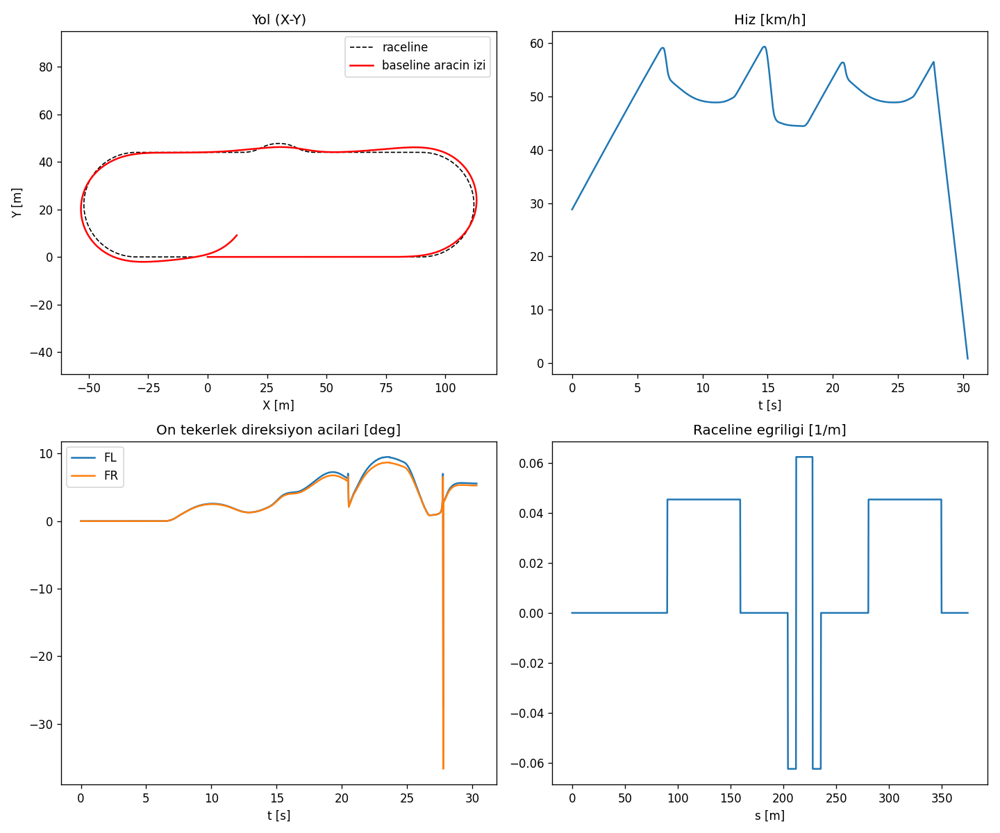
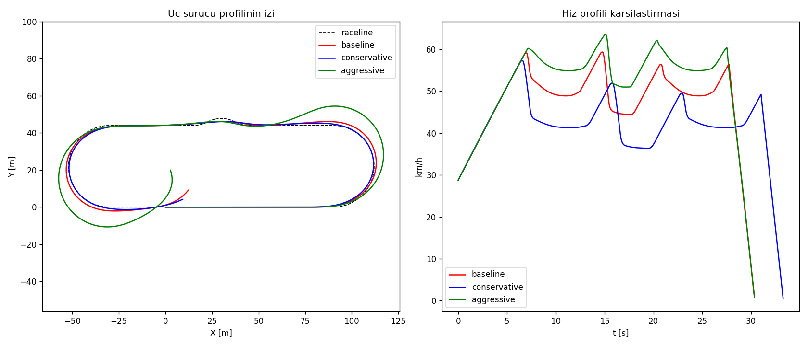
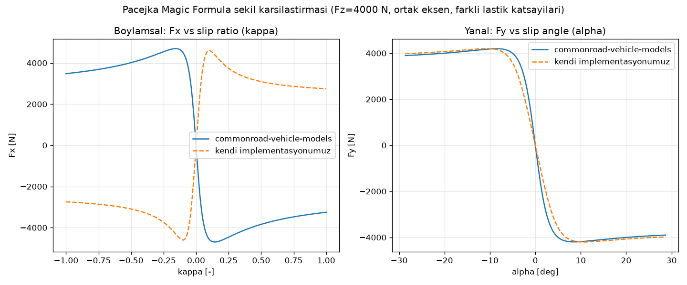
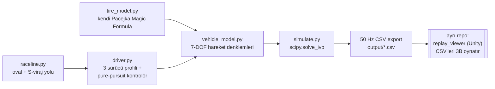

# vehicle_sim — 7-DOF Araç Dinamiği Simülasyonu


[English version →](README.en.md)

Kendi yazılmış Pacejka "Magic Formula" lastik modeline dayanan, 7 serbestlik
derecesine sahip bir araç dinamiği simülasyonu. Sabit bir raceline üzerinde
üç farklı sürücü profili (baseline/conservative/aggressive) `scipy.solve_ivp`
ile çözülür ve sonuçlar 50 Hz CSV olarak dışa aktarılır — bu CSV'ler ayrı bir
repo olan **replay_viewer** (Unity) tarafından 3B olarak oynatılır.

## Görseller

| Tek sürücü doğrulama grafiği | Üç sürücü karşılaştırması | Pacejka doğrulama |
|---|---|---|
|  |  |  |

## Mimari / Veri Akışı



## 7 DOF'un tanımı

Dinamik serbestlik dereceleri (her birinin kendi ataleti/genelleştirilmiş
kuvveti var):

1. `vx` — gövde-eksenli boylamsal hız
2. `vy` — gövde-eksenli yanal hız
3. `r` — yaw açısal hızı
4-7. `w_fl, w_fr, w_rl, w_rr` — dört tekerleğin dönüş hızı

Ride (dikey sekme), roll ve pitch için ayrı durum değişkenleri **eklenmedi**;
bunun yerine bu üçü, tekerlek normal yüklerini (Fz) etkileyen **kuazi-statik
bir yük transferi modeliyle** temsil edildi (`vehicle_model._wheel_normal_loads`):
boylamsal ivme ön/arka arasında, yanal ivme sol/sağ arasında yük kaydırıyor.
Bu, görev tanımında açıkça izin verilen "en azından longitudinal+lateral+yaw+4
tekerlek" seçeneğidir ve tam gerekçesi `vehicle_model.py`'nin başındaki
docstring'de yazılıdır.

Ayrıca `X, Y, psi` (dünya konumu/yönelimi) kinematik olarak entegre edilir —
bunlar 7 dinamik DOF'a dahil değildir (kendi ataletleri yoktur) ama aracı
dünyada konumlandırmak ve CSV/Unity replay'i için gereklidir.

## Kod yapısı

| Dosya | Görev |
|---|---|
| `tire_model.py` | Kendi Pacejka Magic Formula implementasyonumuz (long. + lateral + friction-circle combined slip). Hiçbir üçüncü parti lastik kütüphanesi import edilmez. |
| `vehicle_model.py` | 7-DOF hareket denklemleri, Ackermann direksiyon, kuazi-statik yük transferi. |
| `raceline.py` | Sabit "oval + S-viraj" raceline (analitik yay uzunluğu parametrizasyonu). |
| `driver.py` | Üç sürücü profili (baseline/conservative/aggressive) + pure-pursuit path-following kontrolörü + eğriliğe dayalı hız profili. |
| `simulate.py` | `scipy.integrate.solve_ivp` çözümü + 50 Hz CSV çıkışı. |
| `validate_tire.py` | Kendi Pacejka'mızı `commonroad-vehicle-models` (GPLv3) paketinin tire model fonksiyonlarıyla **sadece eğri şekli** açısından karşılaştırır (ayrı bir venv'de, ana bağımlılık değil). |
| `run_single.py` | FAZ 1: tek profil (baseline), doğrulama grafiği. |
| `run_all.py` | FAZ 2: üç profil + raceline.csv + karşılaştırma grafiği. |

## Sürücü profilleri

| Profil | corner_speed_mult | brake_margin | throttle_aggr |
|---|---|---|---|
| baseline | 1.00 | 1.00 | 1.00 |
| conservative | 0.82 (virajlarda daha yavaş) | 1.35 (daha erken/yumuşak fren) | 0.70 (daha yumuşak gaz) |
| aggressive | 1.15 (virajlarda daha hızlı) | 0.75 (daha geç/sert fren) | 1.30 (daha sert gaz) |

`driver_comparison.png` üç profilin izini ve hız profilini üst üste
gösterir: aggressive belirgin şekilde daha geniş/hızlı bir yörünge çiziyor,
conservative daha dar ve yavaş.

## Kurulum ve çalıştırma

```bash
pip install -r requirements.txt

python -m vehicle_sim.run_single   # FAZ 1: tek sürücü, doğrulama grafiği
python -m vehicle_sim.run_all      # FAZ 2: üç sürücü, Unity için CSV'ler

# Pacejka doğrulaması (ayrı bir venv önerilir — commonroad-vehicle-models
# GPLv3'tür ve bu projenin ana bağımlılığı DEĞİLDİR, sadece bu doğrulama
# betiği için kullanılır):
python -m venv /tmp/crvenv && /tmp/crvenv/bin/pip install commonroad-vehicle-models matplotlib numpy
PYTHONPATH=. /tmp/crvenv/bin/python -m vehicle_sim.validate_tire
```

Çıktılar `output/` klasörüne yazılır: `baseline.csv`, `conservative.csv`,
`aggressive.csv`, `raceline.csv` (Unity'nin okuyacağı dosyalar),
`*_validation.png`, `driver_comparison.png`, `tire_validation.png`,
`tire_validation_report.txt`.

## CSV format (50 Hz)

```
time, x, y, yaw_deg, speed, wheel_fl_deg, wheel_fr_deg, wheel_rl_deg, wheel_rr_deg
```

`x,y`: dünya-eksenli konum (x ileri, y sol — bkz. `vehicle_model.py` docstring).
`wheel_*_deg`: Ackermann-düzeltilmiş direksiyon açısı (arka tekerlekler
her zaman 0; FL/FR farklıdır çünkü Ackermann geometrisi uygulanmıştır).

**Unity eksen dönüşümü**: Unity'nin sol-el (X-sağ, Y-yukarı, Z-ileri)
eksen takımına geçerken `ReplayPlayer.cs` (ayrı **replay_viewer** repo'sunda)
şu dönüşümü uygular: `unity.x = csv.x`, `unity.z = csv.y`, `unity.y = 0`,
`unity_yaw_euler_y = 90 - csv.yaw_deg`.

## Pacejka doğrulama sonucu

`validate_tire.py`, kendi implementasyonumuzun ürettiği eğrinin
`commonroad-vehicle-models` kütüphanesiyle **aynı matematiksel yapıyı**
(sıfırdan başlayan tek bir pik, S-dönüşü, pik-sonrası hafif düşüş) ürettiğini
doğrular. Son çalıştırmanın özeti (`output/tire_validation_report.txt`):

| | commonroad-vehicle-models | kendi implementasyonumuz |
|---|---|---|
| Boylamsal pik kayma oranı (kappa*) | -0.158 | -0.103 |
| Boylamsal pik kuvvet [N] | +4695.6 | -4599.2 |
| Boylamsal pik-sonrası düşüş [%] | 30.7 | 40.3 |
| Yanal pik kayma açısı [rad] | -0.149 | -0.187 |
| Yanal pik kuvvet [N] | +4195.6 | +4200.0 |
| Yanal pik-sonrası düşüş [%] | 7.1 | 5.2 |

Boylamsal eksendeki işaret farkı, commonroad'ın `formula_longitudinal()`
fonksiyonunun iç hesaplamadan önce `kappa`'nın işaretini değiştirmesinden
kaynaklanır (iki paket "pozitif slip ratio" için ters işaret kuralı
kullanıyor); eğrilerin **şekli** birebir aynı kalıyor. Mutlak pik değerleri
farklı çünkü iki implementasyon bağımsız seçilmiş, farklı lastik katsayı
setlerine sahip — amaç aynı lastiği modellemek değil, aynı Magic Formula
formülasyonunun doğru uygulandığını göstermektir.

## Kaynakça / References

| Kaynak | Kullanım amacı |
|---|---|
| Pacejka, H. B. — *Tyre and Vehicle Dynamics* (3rd ed., Butterworth-Heinemann, 2012) | Magic Formula'nın akademik/orijinal kaynağı; `tire_model.py`'deki B/C/D/E katsayı yapısı buradan türetilmiştir. |
| [commonroad-vehicle-models](https://gitlab.lrz.de/tum-cps/commonroad-vehicle-models) (GPLv3) | Sadece `validate_tire.py` doğrulama betiğinde, ayrı bir venv'de referans olarak kullanılır — ana projeye dahil değildir. |
| [NumPy](https://numpy.org/) | Sayısal hesaplama (BSD lisanslı). |
| [SciPy](https://scipy.org/) — `scipy.integrate.solve_ivp` | ODE çözümü (BSD lisanslı). |
| [Matplotlib](https://matplotlib.org/) | Doğrulama/karşılaştırma grafikleri (Matplotlib/PSF-uyumlu lisans). |

## Attribution / Esin kaynağı

Bu projenin konsepti, Instagram'da [@veer.alak.sim](https://www.instagram.com/veer.alak.sim/)
hesabının paylaştığı Simulink tabanlı araç dinamiği simülasyonlarından ve
bunların Unreal Engine ile 3B replay'e aktarılmasından esinlenilmiştir.
`vehicle_sim`, bu yaklaşımın **Python (NumPy/SciPy) + Unity** eşdeğeridir:
Simulink → Python/SciPy, Unreal Engine → Unity (ayrı `replay_viewer` repo'su).

## Lisans

[MIT](LICENSE) © 2026 Musa Buğra Demir
